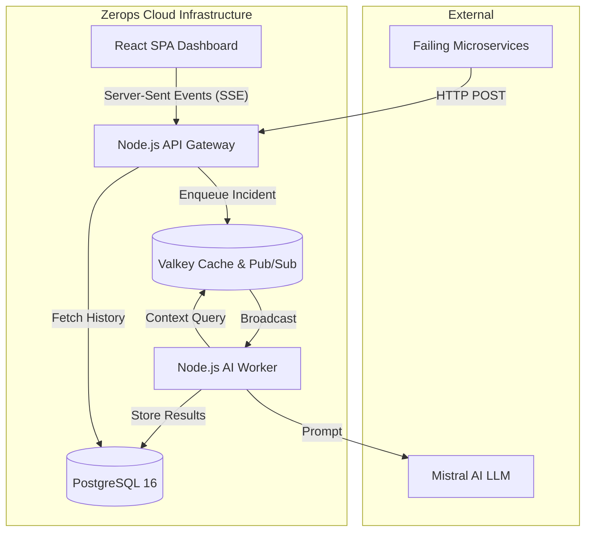

# OutageIQ ⚡

**AI-Powered SRE Incident Room & Automated Root-Cause Analysis**

Built for the Zerops Hackathon, OutageIQ is a production-grade Command Center that catches software errors the second they happen, streams them to your dashboard with zero latency, and leverages **Mistral AI** to instantly analyze your actual codebase, providing an accurate root cause and syntax-highlighted code patch.

---

## 🌟 Key Features

- **Zero-Latency Push (SSE):** Real-time event streaming powered by a Valkey pub/sub architecture. Never hit refresh again.
- **Codebase-Grounded AI:** Upload your project codebase securely. OutageIQ's Mistral AI worker cross-references incoming stack traces against your actual proprietary logic to generate precise patches, not generic guesses.
- **Continuous Learning Loop:** SREs can track which AI patches worked and which failed. OutageIQ uses this historical track record to calculate dynamic Confidence Scores for future incidents.
- **SRE Analytics Dashboard:** A beautiful, responsive, dark-mode command center featuring real-time sparkline frequency charts, fuzzy-search triage filters, and PrismJS syntax-highlighted code diffs.
- **Non-Blocking Architecture:** High-throughput Express API instantly offloads incoming crash payloads to a sub-millisecond Valkey queue, ensuring your production app is never slowed down by heavy AI compute tasks.

---

## 🛠 Project Architecture Stack

OutageIQ is built using a modern, scalable, isolated microservices topology designed for seamless deployment on Zerops:

- **Frontend:** React (Vite SPA)
- **API:** Node.js (Express Gateway)
- **Database:** PostgreSQL 16
- **Cache / Event Bus:** Valkey 7.2
- **Workers:** Node.js (Mistral AI Background Worker)
- **Storage:** Valkey (In-Memory Indexed Codebase Storage)

### 🏗 Architecture Diagram



---

## 🚀 Running Locally

1. **Install Dependencies:**
   ```bash
   npm install
   ```

2. **Environment Variables:**
   Create `.env` files in `apps/api` and `apps/worker` containing:
   ```env
   CACHE_HOST=localhost
   CACHE_PORT=6379
   DB_HOST=localhost
   DB_PORT=5432
   DB_USER=postgres
   DB_PASSWORD=postgres
   DB_NAME=outage_iq
   MISTRAL_API_KEY=your_mistral_key_here
   ```

3. **Start the Development Servers:**
   *Make sure you have local instances of PostgreSQL and Redis/Valkey running.*
   ```bash
   # Terminal 1: Start API Gateway
   npm --workspace=apps/api run dev

   # Terminal 2: Start AI Worker
   npm --workspace=apps/worker run dev

   # Terminal 3: Start React UI
   npm --workspace=apps/web run dev
   ```

---

## ☁️ Zerops Deployment

OutageIQ is heavily optimized for **Zerops.io**. The included `zerops.yaml` file defines the complete infrastructure orchestrating 5 separate services (API Gateway, AI Worker, React UI, PostgreSQL Database, and Valkey Cache).

1. Import the project into Zerops.
2. Provision the PostgreSQL and Valkey services.
3. Add your `MISTRAL_API_KEY` to the Zerops environment secrets.
4. Update the `VITE_API_URL` environment variable in the `app-ui` build step of `zerops.yaml` to point to your live `api-gateway` public URL.
5. Deploy!
